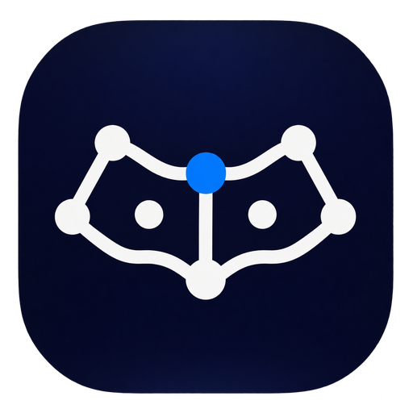
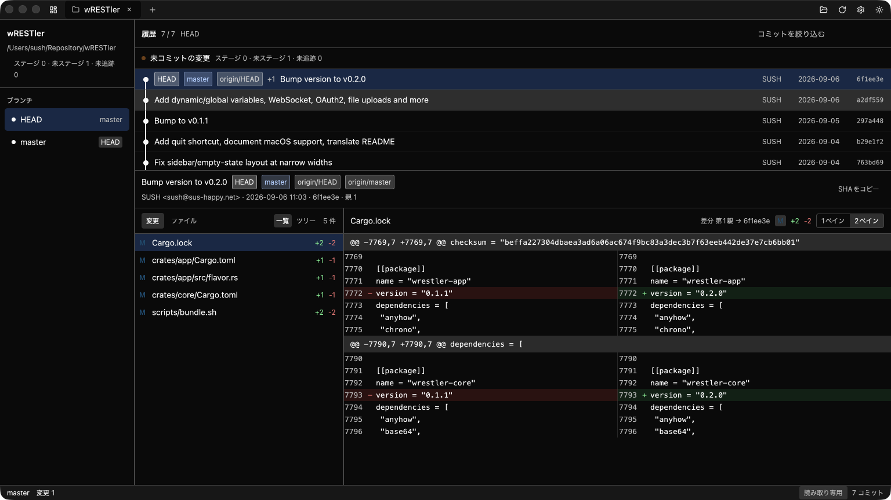
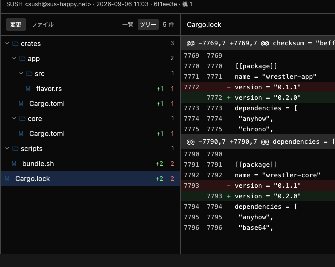
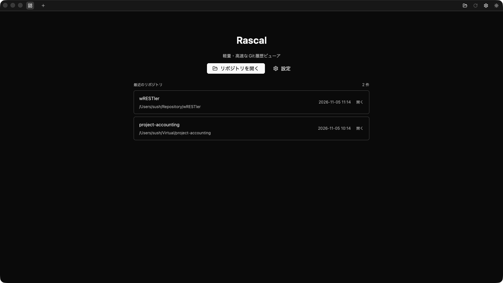
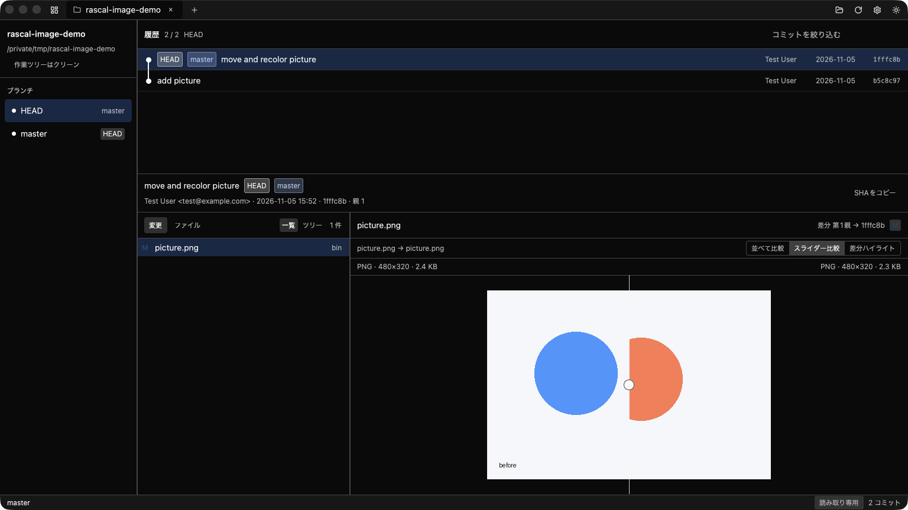
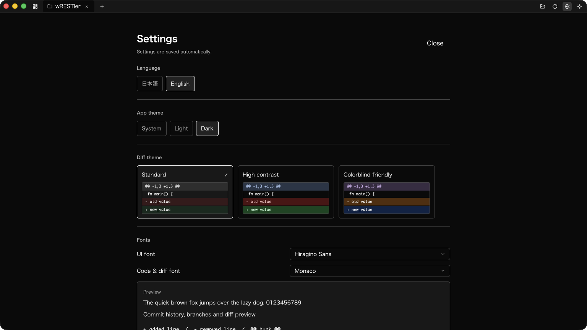
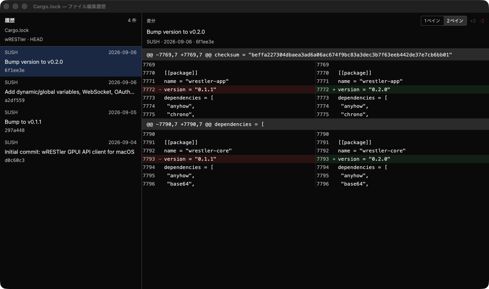

# Rascal

<p align="center">
  
</p>

GPUI で作った、軽量・高速な **読み取り専用** Git 履歴ビューア。













Rascal は「履歴を読む」「変更点を見る」ためだけの Git GUI です。stage、commit、
checkout、fetch/push、merge、cherry-pick などの書き込み操作は行いません。

## 特長

- **コンパクトな履歴表示** — 1コミット1行。作者・日付・SHAを右側に固定配置
- **アイコンだけのタイトルバー操作** — 開く・更新・設定・テーマはホバーでツールチップとショートカットを表示
- **コミットグラフ** — レーン付きの履歴表示。ブランチの分岐・マージを色付きの線で表示
- **高速な履歴ブラウズ** — 仮想リスト、300件ずつのページ読み込み、バックグラウンドの Git ワーカー
- **統合差分ビューア** — 行番号、hunk、追加/削除の色分け、rename、binary、submodule 表示
- **画像プレビュー / 画像差分** — PNG・JPEG・GIF・WebP・BMP・TIFF・SVGに対応。並べて比較 / スライダー比較 / 差分ハイライトを切替
- **CLIコマンド** — 設定ウィンドウから `~/.local/bin/rascal` をインストールし、ターミナルからアプリを起動
- **常時表示スクロールバー** — 履歴、diff、ファイル一覧、設定、ダッシュボードなどでオーバーフロー時に表示
- **1ペイン / 2ペイン差分** — unified と旧/新 side-by-side を各diffヘッダから切替（設定は保存）
- **差分カラーテーマ** — 標準 / 高コントラスト / 色覚配慮（青・オレンジ）をプレビュー付きで選択
- **設定ウィンドウ** — 言語、アプリテーマ、差分テーマ、フォントを一か所で変更
- **日本語 / English** — UI を日本語・英語で切り替え可能
- **フォント選択** — インストール済みフォントをコンボボックスから選択。設定ウィンドウを開いたときに読み込み
- **ダークテーマのコントラスト調整** — 補助テキスト・境界線・選択行・ブランチバッジを見やすく調整
- **ファイルツリー** — コミット時点の全ファイルをディレクトリ単位で遅延読み込みし、内容を表示
- **変更一覧のツリー表示** — 変更ファイルをディレクトリ階層で折りたたみ表示（一覧 / ツリー切替）
- **ファイルツリーのコンテキストメニュー** — 開く、アプリ指定、Finder表示、パスコピー、ファイル編集履歴
- **ファイル編集履歴** — 対象ファイルを変更したコミットと、選択コミットのdiffを2ペインで表示。diff側は1ペイン / 2ペインを切替可能
- **未コミット変更** — staged / unstaged / untracked をグループ表示して差分を閲覧
- **複数リポジトリのタブ** — 複数のリポジトリを同時に開いて切り替え
- **ダッシュボード** — 最近開いたリポジトリを履歴から選択。開いていたタブは次回起動時に復元
- **軽量な UI** — WebView なし、ネットワークアクセスなし、ファイル監視なし
- **ライト / ダークテーマ** — 設定は次回起動時に復元


## 動作環境

- macOS (Apple Silicon を主対象)
- Rust 1.92 以上
- Xcode Command Line Tools
- CMake（同梱 libgit2 のビルド用）

GPUI は `runtime_shaders` 機能でビルドしているため、Metal Toolchain の追加
ダウンロードは不要です。その代わり、初回起動時のみ Metal シェーダーの準備に
少し時間がかかることがあります（2回目以降は高速に起動します）。

## ビルドと起動

### macOSアプリとして起動（アイコン付き・推奨）

```sh
./scripts/bundle-macos.sh
open target/release/Rascal.app
```

`Rascal.app` には `Rascal.icns` が組み込まれ、Finder / Dock にアプリアイコンが表示されます。
リポジトリを引数付きで開く場合:

```sh
open target/release/Rascal.app --args /path/to/repository
```

### 開発用に直接実行

アイコンは `.app` バンドルにのみ適用されます。`cargo run` は開発用です。

```sh
cargo run --release -p rascal-app -- /path/to/repository
```

複数のリポジトリをタブで開く場合:

```sh
cargo run --release -p rascal-app -- /path/to/repo-a /path/to/repo-b
```

引数なしで起動すると、前回終了時に開いていたタブを復元します。
前回のタブがない場合は、最近開いたリポジトリ一覧付きのダッシュボードを表示します。
ダッシュボードはタイトルバー左のアイコン、または `⌘⇧D` でいつでも開けます。

```sh
cargo run --release -p rascal-app
```

CLI:

```text
rascal [repository ...]
rascal --version
rascal --help
```

## CLIコマンド

設定ウィンドウの **コマンドライン** からインストールできます。

- インストール先: `~/.local/bin/rascal`
- sudoやシェル設定の自動変更は行いません
- `~/.local/bin` がPATHにない場合は設定例を表示します

```sh
rascal
rascal /path/to/repository
```

`Rascal.app` から起動した場合のみインストールできます。アプリを移動した場合は
再インストールするか、同じbundle IDで登録されたアプリが起動されます。
Rascalがすでに起動している場合でも、指定したリポジトリが既存ウィンドウの
タブとして開きます。相対パス・スペースを含むパス・複数リポジトリに対応します。

古い形式のCLIラッパーがインストールされている場合は、Rascalの起動時に
自動で新しいラッパーへ更新されます。

## 操作

| 操作 | キー |
| --- | --- |
| リポジトリを開く | `⌘O` |
| 更新 | `⌘R` |
| ダッシュボード | `⌘⇧D` |
| 設定 | `⌘,` |
| コミットを絞り込む | `⌘F` |
| タブを閉じる | `⌘W` |
| ウィンドウを閉じる | `⌘⇧W` |
| テーマ切替 | `⌘⇧T` |
| 履歴の移動 | `↑` / `↓` |
| 終了 | `⌘Q` |

- ダッシュボードの **最近のリポジトリ** から過去に開いたリポジトリを選択できます。
  開いていたタブは終了時に保存され、次回起動時に自動で復元されます。
- 左サイドバーの **HEAD** またはブランチをクリックすると、その履歴を表示します。
  チェックアウトは行いません。
- 履歴の **未コミットの変更** 行をクリックすると、作業ツリーの差分を表示します。
- 下段の **変更 / ファイル** で、コミットの変更ファイルとコミット時点のファイルツリーを
  切り替えます。**変更** の中では **一覧 / ツリー** を切り替えられ、変更ファイルを
  ディレクトリ階層で折りたためます。
- **SHAをコピー** でコミットハッシュをクリップボードへコピーします。
- 画像ファイルはそのままプレビューでき、コミット / 作業ツリーの画像変更は
  **並べて比較 / スライダー比較 / 差分ハイライト** の3モードで確認できます。
- 画像比較の表示モードはアプリ共通で保存されます。ズーム・パンは行いません。
- `⌘W` で現在のタブを閉じます。最後のタブを閉じるとダッシュボードが表示されます。
  ダッシュボード表示中またはタブがない状態で `⌘W` を押すとウィンドウが閉じます。
- `⌘⇧W` でタブの有無にかかわらずウィンドウを閉じます。最後のウィンドウを閉じるとアプリを終了します。
- 設定ウィンドウとファイル編集履歴ウィンドウでは、`⌘W` / `⌘⇧W` でそのウィンドウだけを閉じます。
- 差分ヘッダの **1ペイン / 2ペイン** で、unified差分と旧/新のside-by-side差分を切り替えます。
  選択はアプリ共通で保存され、メイン画面とファイル編集履歴の両方に反映されます。
- ファイル一覧・ファイルツリーのファイルを右クリックすると、次のメニューが開きます。
  - 開く / アプリを指定して開く
  - 対象フォルダをFinderで開く
  - 絶対パスをコピー / 相対パスをコピー
  - ファイル編集履歴（履歴とdiffを2ペインで表示する別ウィンドウ）
- マージコミットの差分は第1親との差分です。
- タイトルバーの歯車アイコン、またはメニューの「Rascal > 設定…」（`⌘,`）で
  設定ウィンドウを開きます。ダッシュボードの **設定** ボタンからも開けます。
  メインウィンドウはそのまま残ります。差分テーマはプレビューを見ながら選択できます。
- 設定ウィンドウは1つだけ開けます。再度開くと既存の設定ウィンドウが前面に出ます。
- 設定ウィンドウでは UI の言語（日本語 / English）、アプリテーマ、差分テーマ、
  UI フォント、コード・差分フォントを変更できます。変更内容は自動保存されます。
- フォントはインストール済みフォントからコンボボックスで選択します。フォント一覧は
  設定ウィンドウを開いたときに読み込まれ、アプリ起動時には走査しません。

## 設計

```
crates/rascal-core/   Git の読み取り専用エンジン（GPUI非依存）
  repo.rs             リポジトリ情報・ブランチ・status
  history.rs          revwalk・refs 装飾・ページング
  diff.rs             コミット詳細・統合差分
  worktree.rs         staged / unstaged / untracked
  tree.rs             遅延ツリー・blob 内容
  graph.rs            コミットグラフのレーン配置（純粋関数）

crates/rascal-app/    GPUI UI とバイナリ
  app.rs              タイトルバー・タブ・ダッシュボード・メニュー
  session.rs          1リポジトリ分の状態・描画・ファイルコンテキストメニュー
  settings.rs         設定ウィンドウ
  file_history.rs     ファイル編集履歴ウィンドウ
  ui/image_view.rs    画像プレビュー・画像比較
scripts/
  bundle-macos.sh     .app バンドル作成（アイコン・Info.plist・ad-hoc署名）
  git_worker.rs       タブごとの Git ワーカースレッド
  storage.rs          最近のリポジトリ・タブセッション・テーマの保存
  ui/                 グラフ描画ヘルパー
```

- Git 処理はタブごとの専用スレッドで実行し、UI スレッドでは `git2::Repository` を
  触りません。結果は `async-channel` で plain data として返します。
- 履歴は 300 件/page。差分・ファイルツリー・ファイル内容は選択時に遅延ロードします。
- 大きな差分（20,000行）、大きなファイル（2MB / 50,000行）、大量のツリー項目には
  上限を設け、UI に省略表示を出します。
- 状態は `~/Library/Application Support/Rascal/state.json` に保存します。
  最近のリポジトリ（最大20件）、開いていたタブ、アクティブタブ、テーマ、差分テーマ、
  言語、UI / コードフォント、差分レイアウト（1ペイン / 2ペイン）、画像比較モードを保持します。

## テスト

```sh
cargo test --workspace
cargo clippy --workspace --all-targets -- -D warnings
cargo fmt --all -- --check
```

`rascal-core` のテストは `tempfile` 上に git2 でリポジトリを作り、履歴・refs・
差分・rename・binary・worktree・ツリー・blob を検証します。

## 制約

- 読み取り専用です。リポジトリを変更する操作はありません。
- マージコミットは第1親との差分のみ表示します（combined diff なし）。
- シンタックスハイライトは未対応です。
- 画像はプレビューと比較に対応していますが、ズーム・パン・画像一覧サムネイルは未対応です。
- 画像比較のスライダーは観賞用の比較で、ピクセル単位の差分しきい値は固定です。
- 画像は1枚20MiB、8192px、差分計算は1600万ピクセルまでに制限しています。
- Git LFSのpointerは画像として取得しません。
- ファイル監視は行いません。外部で変更した場合は `⌘R` で更新してください。
  ウィンドウのアクティブ化時にはメタ情報だけ再取得します。
- UI は日本語 / English に対応しています。

## ライセンス

MIT（`Cargo.toml` の設定）。依存クレートのライセンスは各クレートに従います。
